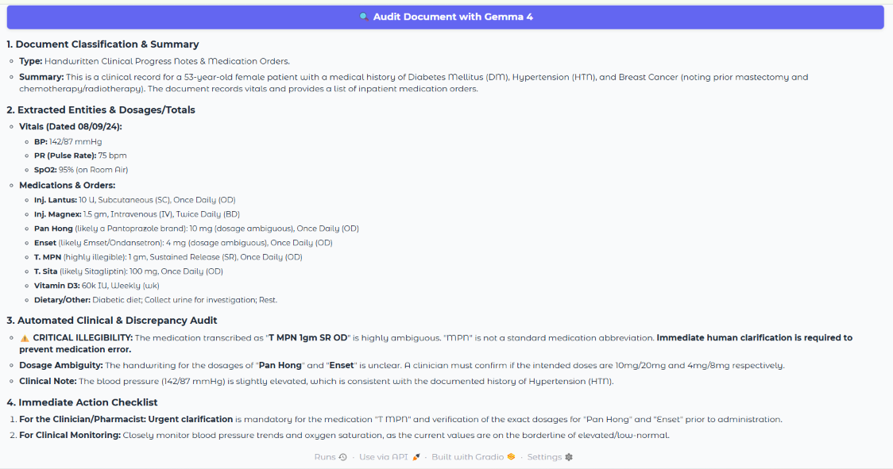

# DocuSnap-Rx: Multimodal Clinical & Prescription Auditor

**DocuSnap-Rx** is an open-source, local-first multimodal clinical auditor powered by **Gemma 4 (`gemma-4-26b-a4b-it`)**. Built during **Hacktoberfest 2026 at Sardar Patel Institute of Technology (SPIT), Mumbai**, it extracts handwritten medical records, verifies prescribed dosages, and flags real-time clinical discrepancies while maintaining strict patient data privacy.

---

## Demo & Screenshots



---

## Key Architectural Features

- **Multimodal Clinical Extraction:** Leverages `gemma-4-26b-a4b-it` to parse complex handwritten prescription notes, lab reports, and clinical summaries directly from document images.
- **Real-Time Dosage Verification:** Automatically audits active ingredients, checks recommended intake thresholds, and flags adverse drug-drug interactions.
- **On-Device & Air-Gapped Privacy:** Processes sensitive Patient Health Information (PHI) entirely locally with zero external API calls or cloud logging.
- **Clinical Discrepancy Auditor:** Cross-references patient vitals against lab metrics to highlight out-of-range clinical parameters instantly.
- **Interactive Medical Dashboard:** Built with Gradio for seamless document uploading, visual inspection, and diagnostic audit reports.

---

## System Architecture & Tech Stack


```

[ Prescription / Medical Report Image ]
            │
            ▼
┌───────────────────────┐
│   Local Image Loader  │ (PIL / Vision Preprocessing)
└───────────┬───────────┘
            │
            ▼
┌───────────────────────┐
│   Gemma 4 Backbone    │ (gemma-4-26b-a4b-it via PyTorch)
└───────────┬───────────┘
            │ Extracted & Audited Clinical JSON
            ▼
┌───────────────────────┐
│  Gradio Audit UI      │ (Real-Time Discrepancy & Dosage Alerts)
└───────────────────────┘

```

- **Core Model:** `gemma-4-26b-a4b-it`
- **Language & Frameworks:** Python 3.10+, PyTorch, Hugging Face `transformers`, `accelerate`
- **Frontend / Interface:** Gradio (`gr.Blocks`)
- **Image Processing:** `Pillow` (PIL)

---

## Quickstart & Local Setup

### 1. Repository Installation

```bash
# Clone the repository
git clone [https://github.com/Adibshaikh2209/DocuSnap-Rx.git](https://github.com/Adibshaikh2209/DocuSnap-Rx.git)
cd DocuSnap-Rx

# Create a virtual environment
python -m venv venv
source venv/bin/activate   # On Windows: venv\Scripts\activate

# Install dependencies
pip install -r requirements.txt

```

### 2. Running the Auditor

```bash
python app.py

```

Open your browser and navigate to the local server URL displayed in your terminal (typically `http://127.0.0.1:7860`).

---

## Dependencies (`requirements.txt`)

```text
torch>=2.0.0
transformers>=4.40.0
gradio>=4.0.0
Pillow>=9.5.0
accelerate>=0.28.0

```

---

## Medical Disclaimer

*DocuSnap-Rx is an experimental open-source clinical decision support tool built for hackathons and research purposes. It is NOT intended to replace professional clinical judgment, official diagnosis, or direct physician prescription verification. Always consult a certified medical practitioner.*

---

## License

This project is open-source under the MIT License. Built with at Hacktoberfest 2026 (SPIT Mumbai).

```

```
